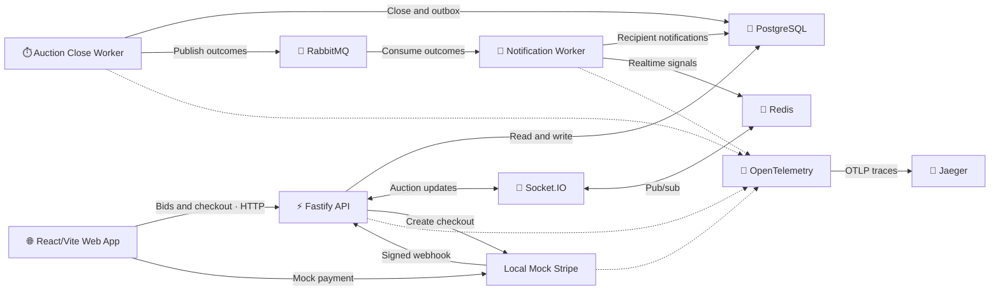

# Auction House

A TypeScript auction application built with React/Vite, Fastify, PostgreSQL and Zod. Eight self-contained stages develop bidding, concurrency rules, realtime updates, asynchronous closing, winner checkout and distributed tracing.

## Repository layout

- [`workshop/`](workshop/) contains the working application stages and their verification instructions.
- [`reference/`](reference/) contains the corresponding reference implementations. Each stage has its own README and runtime configuration.
- [`class-delivery-learner-commands/`](class-delivery-learner-commands/) contains learner command guides.
- [`auctionhouse-throwaway/`](auctionhouse-throwaway/) contains the earlier prototype.

## Start the complete application

Install Node.js 24 LTS with npm, Docker with Docker Compose, and Google Chrome for the headed browser demonstrations. Run Docker before starting the services.

```sh
cd workshop/part-8-cross-stack-debugging
npm ci
npm start
```

Open the application at [localhost:5108](http://localhost:5108) and Jaeger at [localhost:16686](http://localhost:16686). Startup prepares PostgreSQL, Redis, RabbitMQ and Jaeger, applies migrations, and runs the application services. Normal startup preserves data; `db:reset` deletes the selected stage's database.

Checkout uses a local Stripe-shaped mock; no real money moves. Selectable demo users exercise application roles and are not a production sign-in system.

See the [Part 8 README](workshop/part-8-cross-stack-debugging/README.md) for service addresses, mock payment cards, trace inspection, recovery behavior and the complete browser walkthrough. Follow the README inside a selected stage when running an earlier implementation.

## Application stages

| Stage | Capability |
| --- | --- |
| [1 · Foundation](workshop/part-1-foundation/) | Application and database foundation |
| [2 · Create auction and bid](workshop/part-2-create-auction-and-bid/) | Publish auctions and place bids |
| [3 · Business rules and concurrency](workshop/part-3-business-rules-concurrency/) | Authoritative bidding rules and concurrent requests |
| [4 · Realtime](workshop/part-4-realtime-socketio-redis/) | Socket.IO updates with Redis |
| [5 · Hidden defect review](workshop/part-5-hidden-defect-review/) | Review and investigate application defects |
| [6 · Asynchronous close](workshop/part-6-async-close-rabbitmq/) | Auction closing and RabbitMQ notifications |
| [7 · Winner checkout](workshop/part-7-winner-checkout/) | Winner authorization, mock payments and recovery |
| [8 · Cross-stack debugging](workshop/part-8-cross-stack-debugging/) | OpenTelemetry workflow tracing in Jaeger |

## Verify and demonstrate Part 8

With the application running, use a second terminal in the same stage directory:

```sh
npm test
npm run build
npm run test:golden-trace -- --headless
```

For interactive demonstrations in separate Chrome windows:

```sh
npm run test:bidding-war
# Or run the full payment and trace walkthrough:
npm run test:golden-trace
```

Headed demonstrations leave their windows open for inspection. Allow telemetry to flush during graceful shutdown. Stage-specific checks and browser review steps are documented in each stage's `AGENTS.md` and README.

## Complete application architecture


