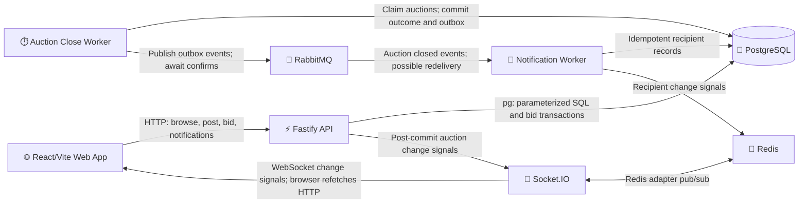

# ORM safety recommendation

Date: 2026-11-15. Addresses [issue #9](https://github.com/spa-raj/codex-course/issues/9).
Scope: all application parts present in this checkout, reviewed at `7b68386`.

## Recommendation

Keep `pg`, parameterized SQL, and explicit SQL migrations. Do not replace the
application's SQL with an ORM solely to improve safety. Schema-aware query typing
is a useful potential improvement, but the concrete bidding defect here concerns
statement snapshots and lock ordering, which an ORM does not automatically fix.

This is a documented recommendation, not an ORM migration or a certification that
every part is production-safe. No application code, dependencies, schema, or
historical part behavior changes with this decision.

## Evidence in this repository

The implemented applications are Parts 1–6. Parts 7 and 8 contain no application
files in this checkout, despite their descriptions in the root README. The
separate [Stripe-shaped service](../stripe-service/src/app.ts) stores sessions in
memory and has no SQL data-access layer to replace.

| Part | Observed data access | Safety implication |
| --- | --- | --- |
| [1: foundation](../part-1-foundation/server/src/app.ts) | Health check uses constant `SELECT 1`; migrations use `pg`. | No user-derived query text or meaningful ORM use case in the health path. |
| [2: auctions and bids](../part-2-create-auction-and-bid/server/src/app.ts) | Values use `$n` placeholders; Zod validates requests; bidding reads then inserts without an auction lock. | Parameterization protects the reviewed value positions against injection; concurrent bidding remains unsafe. |
| [3: concurrency](../part-3-business-rules-concurrency/server/src/app.ts) | A checked-out client locks the auction, then reads price in a separate statement, checks the deadline, inserts, and commits. | Safety depends on this sequence, not on SQL being handwritten or generated. |
| [4: realtime](../part-4-realtime-socketio-redis/server/src/app.ts) | Preserves the Part 3 bidding transaction; signals realtime changes after commit. | Replacing data access must preserve both concurrency and commit-before-notify behavior. |
| [5: defect review](../part-5-hidden-defect-review/server/src/app.ts) | Reads the lateral top-bid projection and takes `FOR UPDATE OF a` in the same statement. | The price can come from the statement's pre-wait snapshot. Existing concurrency tests reproduce accepted equal bids and an outdated price after waiting. |
| [6: closing and notifications](../part-6-async-close-rabbitmq/server/src/close-auctions.ts) | Preserves the separate lock/read bid path; closers claim with `FOR UPDATE OF a SKIP LOCKED`, recheck outcomes, read bids separately, and commit outcome plus outbox together. | Preserve worker claim semantics, fresh reads, rollback, and database uniqueness through any future abstraction. |

In Parts 2–6, catalog SQL interpolates `auctionSelect` and `order`, but both are
server-owned SQL: `order` comes from a fixed map selected by a Zod enum. Search
text and category are separate parameters. The reviewed interpolation is not
evidence of an injection vulnerability. Never replace that map with request text.
The shared [database helper](../scripts/workshop-db) similarly restricts database
names to `auction_part_[1-8]`; its SQL interpolation is not unrestricted input.

## What “safer” means here

### SQL injection

Keep query text separate from values. PostgreSQL parameters cannot stand for
identifiers or sort expressions, so keep those choices allowlisted. An ORM's
parameterized APIs can provide the same protection, but adopting one adds little
to value positions already parameterized. Raw-string escape hatches still require
review. See [node-postgres query guidance](https://node-postgres.com/features/queries).

### Compile-time schema and result safety

There is a real gap: `query<AuctionRow>(sql)` supplies a TypeScript row type; it
does not prove that SQL returns those columns or that the deployed schema matches.
Some calls omit a row type altogether. Parts 3–6 explicitly map auction `Date`
fields to ISO strings, while bid queries still declare the shared HTTP `Bid` type
directly. Part 2 similarly declares `Auction` against driver rows. JSON serialization
can make HTTP output correct while those intermediate TypeScript types remain
inaccurate. The [driver's type conversions](https://node-postgres.com/features/types)
and [query declarations](https://github.com/DefinitelyTyped/DefinitelyTyped/blob/master/types/pg/index.d.ts)
explain why row types and runtime values need separate attention.

An ORM or typed query builder can derive column, selection, and nullability types
from a schema definition. That helps catch refactoring mistakes, provided its
schema matches the database. It does not replace runtime validation of HTTP input,
broker messages, or JSON payloads. Part 6 already treats outbox payloads as
`unknown` and parses them with Zod in [outbox publication](../part-6-async-close-rabbitmq/server/src/outbox.ts).

### Concurrent bidding and closing

Use one checked-out client for the complete transaction; `pool.query` is not a
transaction handle. Preserve `BEGIN` → auction lock → separate current-price read
→ post-lock acceptance-time check → insert → `COMMIT`, with rollback and release
on other paths. See [node-postgres transactions](https://node-postgres.com/features/transactions).

At PostgreSQL's default Read Committed isolation, each statement gets a snapshot.
Locking the auction row does not refresh an earlier snapshot of related bid rows.
This explains why Part 5's combined query can be wrong despite using a transaction
and `FOR UPDATE`, whereas Parts 3, 4, and 6 use a subsequent statement. An ORM
transaction wrapper alone would preserve the same defect if it emitted the same
query sequence. See [PostgreSQL 16 isolation](https://www.postgresql.org/docs/16/transaction-iso.html)
and [row locking](https://www.postgresql.org/docs/16/explicit-locking.html#LOCKING-ROWS).

### Stored integrity, delivery, and authorization

Preserve foreign keys, checks, and uniqueness in reviewed migrations. In Part 6,
[migration 002](../part-6-async-close-rabbitmq/server/migrations/002_auction_outcomes.sql)
enforces one outcome/outbox event per auction and a composite reference tying a
winner and amount to the actual bid. [Migration 003](../part-6-async-close-rabbitmq/server/migrations/003_recipient_notifications.sql)
enforces one notification per event and recipient. These constraints complement
application logic; ordinary `CHECK` constraints cannot enforce arbitrary
cross-row bidding rules. See [PostgreSQL 16 constraints](https://www.postgresql.org/docs/16/ddl-constraints.html).

Keep outcome/outbox atomicity, confirm-before-publication marking, and idempotent
recipient inserts. An ORM cannot make PostgreSQL and RabbitMQ one atomic commit;
the current [outbox](../part-6-async-close-rabbitmq/server/src/outbox.ts) and
[notification persistence](../part-6-async-close-rabbitmq/server/src/notifications.ts)
are designed to tolerate redelivery. Also, `x-demo-user-id` is caller-selected
identity, not authentication. ORM adoption would not authenticate users or enforce
ownership automatically.

## Alternatives and tradeoffs

| Approach | Benefit | Cost or remaining obligation | Recommendation |
| --- | --- | --- | --- |
| Keep `pg` with targeted hardening | Preserves explicit PostgreSQL behavior and existing migration/test paths. | Manual SQL/result alignment and transaction discipline remain. | Use now. |
| Add a schema-aware SQL builder such as Drizzle | Inferred selections and nullability; parameterized SQL composition; transaction API. | Maintain schema definitions and database alignment; review generated SQL and raw fragments; preserve lock/read order. | Consider a narrow pilot if type drift becomes a recurring problem. |
| Adopt Prisma | Generated contract/client types, structured data access, and transaction ergonomics. | Introduces contract generation/tooling and migration ownership decisions; complex query semantics and runtime validation still need review. | No demonstrated safety gain justifies a repository-wide rewrite now. |

Drizzle documents [typed selections](https://orm.drizzle.team/docs/select),
[transactions](https://orm.drizzle.team/docs/transactions), and a parameterized
[`sql` template](https://orm.drizzle.team/docs/sql). Its `sql<T>` annotation does
not validate or convert runtime results; `sql.raw` bypasses escaping.

Current Prisma documentation describes a generated contract and explicit
[row-locking APIs](https://www.prisma.io/docs/orm/reference/orm-client#row-locking).
It is not correct to assume Prisma cannot express locks. Its
[transaction API](https://www.prisma.io/docs/orm/reference/transactions-and-runtime)
still requires queries through the transaction handle, and
[raw query facilities](https://www.prisma.io/docs/orm/reference/raw-queries)
still require safe composition. A future pilot must pin a version and assess its
actual capabilities. Neither option is rejected because of an assumed inability
to use PostgreSQL; the judgment here is that migration cost is not supported by
the safety evidence.

## Recommended follow-up and reconsideration gate

1. Retain parameterization, static identifier/sort maps, Zod boundaries, and explicit
   migrations. Add hostile search/title and invalid-sort regression cases when
   extending those paths; existing punctuation tests alone are not a full injection audit.
2. Correct driver-row versus HTTP types at data-access boundaries, with explicit
   date/null/JSON mapping and runtime validation where data crosses a trust boundary.
   Keep reusable queries close to their row types rather than adding a general ORM layer.
3. For an application shipping the Part 5 bid path, fix the lock-then-read sequence
   and require its existing concurrency tests to pass. Preserve Part 2 and Part 5
   as separate historical versions in this recommendation PR; a behavior change
   belongs in an explicitly scoped implementation change.
4. Reconsider a builder/ORM when repeated schema/result drift or measurable query
   maintenance cost warrants it. Pilot a catalog read, a contended bid, and the
   close/outbox path. Require equivalent SQL parameterization, locking, deadline
   behavior, rollback, constraints, redelivery, and date/null/JSON results against
   real PostgreSQL before expanding adoption. Keep one authoritative migration
   history; do not introduce a second schema writer or rewrite applied migrations.

These follow-ups are recommendations, not implemented changes or prerequisites
silently satisfied by choosing an ORM. No performance improvement is claimed;
benchmark representative queries before using performance to justify adoption.

## Architecture retained

Parts 1–3 use the HTTP/database path. Parts 4–5 add realtime transport; Part 6
adds the closing and notification workers shown below.

## Validation

Ran each implemented part's documented `npm test` against the existing local
PostgreSQL/Redis/RabbitMQ services. Ran `npm run build` in Parts 2–6; all passed,
including strict TypeScript checks. Part 1 has no root build script.

| Part | Test result |
| --- | --- |
| 1 | Server: 1 passed. Web: no test files; command passes with `--passWithNoTests`. |
| 2 | Server: 33 passed. Web: 37 passed. |
| 3 | Default command failed twice: 45 server tests passed, 1 catalog ordering assertion failed. The test assumes its listing is globally newest while another file inserts a closing fixture. Diagnostic `npm run test --workspace server -- --no-file-parallelism` passed all 46; this does not make the default command green. Web run separately: 37 passed. |
| 4 | Server: 48 passed. Web: 37 passed. |
| 5 | Server: 46 passed, 2 concurrency tests failed. Three equal bids returned `[201, 201, 201]` instead of `[201, 409, 409]`; a bid waiting on a price update returned 201 instead of 409. Web run separately: 37 passed. |
| 6 | Server: 66 passed. Web: 37 passed. The documented command also passed again after drafting this recommendation. |

The Part 3 and Part 5 failures were present before the documentation edits; their
application/test sources remain unchanged. Part 5's failures support the locking
finding rather than an injection finding. Assertions were not changed or weakened.
Part 6's tests cover bid lock waits, post-lock deadlines, concurrent closers,
outcome/outbox rollback and uniqueness, broker confirms/redelivery, recipient
idempotency, and Redis/Socket.IO delivery.

Checked local Markdown link targets, balanced code fences, and `git diff --check`.
There are no changed HTTP or browser flows in this documentation-only change;
browser demonstrations were not run. Test logs are under `/tmp/orm-*`, outside
the repository; the commands and failure details above are the durable record.
