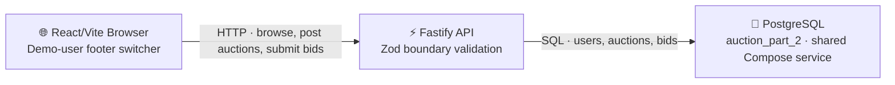

# Posting Auctions and Making Bids — Design Decisions

Status: Slice 1 (browsing and users) accepted. Slice 2 (posting) is complete and verified; Slice 3 (bidding) is implemented and ready for review. This supersedes the earlier two-slice numbering, which grouped posting with browsing.

## Agreed behavior

- Seed ten demo users; provide a footer user switcher. No real authentication.
- Each fresh browser tab randomly selects one of the ten demo users. Save the selection in sessionStorage so navigation and reloads in that tab preserve it. The footer switcher updates only that tab; the top-right header displays the active user’s name. This supersedes the earlier localStorage decision. Independent random assignments may select the same user in different tabs.
- Require title, category, description, condition, location, starting price, and closing time when posting.
- Use category illustrations; no image uploads.
- Publish immediately, with the active user as the seller.
- Store a future closing time as a UTC timestamp.
- Use USD and integer cents. Add thousands-separator commas while entering the starting price, preserve decimal input and normal cursor/editing behavior, and remove display separators when converting to cents.
- Seed the six existing catalog auctions into PostgreSQL.
- Normal startup preserves changes. Explicit reset restores Part 2 seed data.
- Sellers cannot bid on their own auctions.
- The API enforces a minimum bid at least $1 above the current amount.
- Disable bidding on ended auctions in the UI and reject it in the API.
- Show bidder, amount, and time in bid history.
- A Sell link opens `/auctions/new`; successful posting opens the new auction detail page.
- New auctions do not require specifications. Hide the specifications section when empty.
- The posting form shows field-level validation, focuses the first invalid field, clears corrected-field feedback, preserves entered values after request failure, and prevents duplicate in-flight submissions.
- Support sequential bidding in Part 2. Concurrency protection is explicitly deferred to Part 3.

## Repository facts

- Part 2 is initially empty; copy the foundation only after implementation approval.
- Part 1 supplies React/Vite UI, Fastify API, PostgreSQL migration runner, and npm commands.
- Its catalog is static and its bid form has no submission behavior.
- Use the PostgreSQL service in the root `docker-compose.yml` (host port 55432).
- The shared database helper supports an isolated `auction_part_2` database.
- Preserve Part 1 and unrelated working-tree changes.

## Agreed round 2 details

- Use direct bids, not automatic maximum bidding; label the form “Your bid.”
- Before the first bid, the current amount is the starting price. Every bid must be at least 100 cents above the current amount: a $100 starting price requires a first bid of at least $101.
- Keep deadlines fixed. At the deadline, show “Ended” and the highest bidder as winner, or “No bids.” Payments, notifications, and fulfillment are excluded.
- Published auctions cannot be edited or cancelled; accepted bids cannot be withdrawn. The current leader may bid again under the same minimum rule.
- Refresh detail pages every five seconds and immediately after bidding. On rejection due to an outdated amount, refresh the price, explain the new minimum, and never automatically resubmit.
- Categories: GPUs, CPUs, Memory, Chassis, Networking, Cooling.
- Conditions: New, Open box, Used, Refurbished. These choices apply to new listings; preserve existing descriptive condition text on seeded listings.
- Require trimmed title (1–120 characters), description (1–5,000), and location (1–120).
- Starting prices range from $0.01 to $1,000,000 with at most two decimal places. Show this range on the form and reject oversized amounts with the $1,000,000 cap message, including extremely long inputs. Bid amounts also use integer cents; the minimum-increase rule applies to bids.
- Enter closing time using a clearly labeled local date/time input, convert to UTC for storage, and show deadlines in the viewer's local timezone. Closing time must be in the future, with no maximum duration. Distinguish a missing date, an impossible/incomplete calendar date (such as February 31), and a real date in the past; only the last case should ask for a future date.
- Seed real, consistent bid histories with the ten demo users, matching the six existing displayed prices and bid counts. Assign sellers from those users without self-bids; preserve descriptions, illustrations, and specifications.
- Calculate seed deadlines relative to initial seeding or explicit reset. Normal startup never moves them forward.
- Keep ended auctions visible. Support text search, category filtering, and sorting by newest, closing soon, and current price. Bid history is newest first.

## Design documents

- [Domain glossary](CONTEXT.md)
- [Demo identity decision](docs/adr/0001-demo-user-identity.md)
- [Sequential bidding boundary](docs/adr/0002-sequential-bidding-boundary.md)
- [Proposed implementation slices and browser checkpoints](IMPLEMENTATION_PLAN.md)

## Architecture

The API owns validation, seller attribution, minimum-bid rules, and deadline enforcement. Browser identity selection is not authentication. PostgreSQL persists records through explicit migrations; Part 2 does not guarantee concurrent-bid correctness.

## Approval and delivery

The user accepted Slice 1 and authorized Slice 2: posting an auction. Verify the complete posting flow, give browser review steps, then stop. Slice 3 bidding was subsequently authorized and is now ready for review. Simultaneous-bid protection remains deferred to Part 3. See [implementation checkpoints](IMPLEMENTATION_PLAN.md) and [verification results](VERIFICATION.md).
