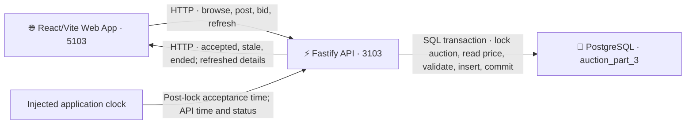

# Concurrent Bidding — Design Decisions

Status: the user approved Slice 1 and authorized Slice 2. Both are implemented and verified. Work stopped after Slice 2 as requested.

## Scope and isolation

- Preserve Part 2 unchanged as the bug-reproduction version.
- Copy without installed dependencies or build outputs.
- Part 3: API 3103, web 5103, database `auction_part_3` on shared PostgreSQL port 55432.
- Preserve existing direct USD bids, integer cents, $1 minimum increase, seller restrictions, fixed deadlines and demo identities.
- Keep the existing stack and UI conventions.

## Decisions

| Topic | Decision |
| --- | --- |
| Concurrency | Serialize bidding using a transaction and an auction-row lock. |
| Validation | Read the current price and validate after acquiring the lock. |
| Stale bids | Reject amounts below the updated minimum; refresh the displayed state. |
| Resubmission | No automatic bid resubmission. |
| Clock | Inject an application clock so tests can control time. |
| Acceptance time | Check time after acquiring the lock. |
| Deadline | Reject bids at or after the closing instant. |
| UI | Switch to “Ended” and disable bidding when the deadline arrives. |
| Tests | Replace duplicate-reproduction assertions with protected-behavior assertions in Part 3 only. |
| Scope | Keep it simple; defer idempotency keys and extra retry mechanisms. |

## Behavioral consequences

- Concurrent equal bids against the same starting state yield one acceptance. Different amounts can both succeed if each meets the minimum when processed; click order does not guarantee acceptance order.
- An amount still meeting the updated minimum remains eligible even if submitted from an older displayed price.
- On stale rejection, preserve input, explain the updated minimum and refresh price/history/minimum. A new bid requires explicit submission.
- A request arriving before closing but acquiring the lock at or after closing is rejected. Read the injected clock after acquiring the lock; reject when `now >= closesAt`.
- Default the injected clock to real time. Related API time/status decisions and acceptance timestamps must agree with that clock, rather than contradicting it through database transaction-start time or independent database-clock predicates.
- Keep five-second detail polling and refresh after bid outcomes. Recheck local time and refresh details immediately when a hidden tab becomes visible or the window regains focus. Refresh at expiry for final history and winner; use the API time reference for the browser countdown. The API remains authoritative.
- Rejected bids do not persist. Failed transactions roll back and release connections and locks. Uncertain network outcomes do not trigger automatic retry.

## Implementation details

- `buildApp({ clock })` accepts a clock returning a Date and defaults to real time. No public clock-control endpoint is exposed. Bidding reads the clock once after the lock and latest-price read; that value determines eligibility and the inserted timestamp.
- Catalog/detail ended status and serverTime use the injected clock. Auction posting retains its existing future-date validation; the injected clock is scoped to bidding and read status.
- Detail reads acquire a shared auction-row lock before reading summary and history, waiting for in-flight accepted bids to commit before reporting the final winner. Other detail readers can proceed concurrently; bids wait until the short read transaction releases its lock.
- At expiry the form disables locally, immediately requests final state and shows “Confirming final result…” until the API confirms closure. Late ended responses also disable the form.

## Existing behavior and verification boundaries

Part 2 already checks sequential minimums and deadlines, polls every five seconds, and preserves failed input. Separate validation and insertion allow conflicting concurrent bids. Its database-clock checks are the copied baseline, not the agreed Part 3 clock design.

Part 3 `test:bidding-war` now requires one equal-bid acceptance and two stale rejections. A row-lock barrier queues requests before validation, rather than requiring contenders to reach insertion together. Preserve Part 2's reproduction and assertions unchanged. Historical records under `docs/part-2-*.md` do not verify Part 3.

## Architecture

No additional service is required. See [clock decision](docs/adr/0003-post-lock-application-clock.md), [domain glossary](CONTEXT.md), and [two proposed slices](IMPLEMENTATION_PLAN.md).

## Approval boundary

1. Serialized bidding and stale-bid recovery.
2. Testable clock and closing-time behavior.

The user reviewed Slice 1 and authorized Slice 2. Complete Slice 2 verification, report results and stop.
