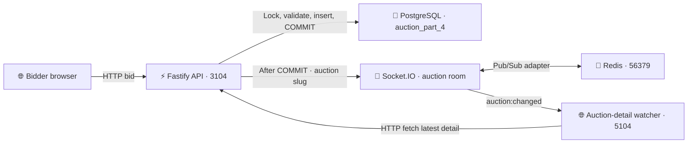

# Live Auction Detail — Agreed Design

Status: Slice 1 approved, implemented and verified. Stopped for review; no additional slice is authorized.

## Confirmed decisions

The user's decision image overrides the earlier multi-instance proposal. Unanswered questions use the recommended choices from round 1. The user explicitly authorized Slice 1 without another planning round.

| Topic | Agreed behavior |
| --- | --- |
| Scope | Auction-detail pages only; no catalog live updates. |
| Deployment | One application instance, one Redis server; no multi-replica demonstration. |
| Correctness | Preserve Part 3 row locking, post-lock clock, minimum bids, deadline protection and coherent detail reads. |
| Publication | Notify only after a successful bid COMMIT; rejected or rolled-back bids emit nothing. |
| Event | auction:changed with only the auction slug; fetch authoritative state through HTTP. |
| Watchers | Public auction-specific room, including sellers. A connection watches one auction; leaving the detail page disconnects. Demo identity is not authentication. |
| Recovery | Subscribe before catch-up fetch, refetch after reconnect, preserve focus/visibility and expiry refreshes plus five-second reconciliation polling. |
| Delivery | Best effort. A Redis failure cannot turn a committed bid into a failed bid; log failure. No durable outbox or replay guarantee. |
| Startup | Redis publisher/subscriber must connect before readiness, with a five-second startup deadline. Health checks include database and Redis. |
| Drafts | Preserve typed amounts on external updates. No automatic increase or resubmission. |
| Fetch races | Coalesce notifications, but remember one follow-up fetch when a trigger arrives during an existing read. |
| Transport | WebSocket-only Socket.IO through Vite proxy. |
| Feedback | Small Live / Reconnecting indicator; retain stale-data warnings. Healthy local target: another viewer updates within one second. |
| Isolation | API 3104, web 5104, database auction_part_4, distinct tab identity and Redis channel prefix. |

## Architecture

The Redis adapter publishes broadcasts and also delivers to local matching sockets. With the agreed single application instance, browser delivery is local; an independent Redis subscriber verifies that the backplane actually receives the publication. No claim of cross-instance verification is made.

## Official documentation

- [Redis adapter](https://socket.io/docs/v4/redis-adapter/): Redis Pub/Sub broadcasts and no connection-state recovery.
- [Delivery guarantees](https://socket.io/docs/v4/delivery-guarantees/): default at-most-once delivery; disconnected clients miss server events.
- [Rooms](https://socket.io/docs/v4/rooms/): server-managed targeted subscriptions.
- [Multiple nodes](https://socket.io/docs/v4/using-multiple-nodes/): WebSocket-only avoids HTTP polling affinity requirements if deployment is expanded later.

## Accepted limitation

There is a commit-to-publication crash window. Polling and reconnect catch-up recover displayed state, but events are not durably replayed. Redis availability is a readiness requirement; bids already in progress keep their committed outcome if publication fails.
