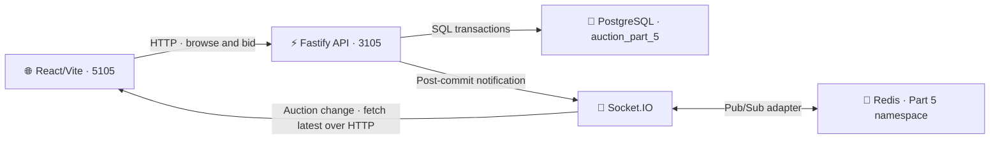

# Part 5 — Verification

Part 5 uses API 3105, web 5105, database auction_part_5, tab identity auction-part-5-active-user and Redis prefix auction-part-5:socket.io. Shared service configuration is unchanged. Earlier verification records under docs/ apply only to their original parts.

## Current checks

- Baseline copy excludes installed dependencies, generated build/test output, logs and local environment files. Dependencies were installed independently afterward for validation; generated files remain ignored.
- npm run db:up, npm run redis:up and npm run migrate succeeded against the Part 5 database.
- npm run build passed, including strict TypeScript checks for server, web and browser scripts.
- npm test: 46 server tests passed and 2 failed. Existing behavioral assertions were retained. The suite is not fully passing; investigate its regression failures.
- Web tests run separately because the server failures stop the root test command: 37 passed.
- Browser smoke check: health page, ordinary bid submission, sequential stale-bid rejection, Socket.IO-driven watcher update with polling disabled, and preservation of the watcher draft passed.
- Part 4 source/documentation fingerprints checked after preparation: all 54 unchanged. Git changes are confined to Part 5 and remain uncommitted.

Detailed execution logs are outside the repository under /tmp/part5-tests.log, /tmp/part5-build.log, /tmp/part5-web-tests.log and /tmp/part5-browser-smoke.log.

## Architecture

