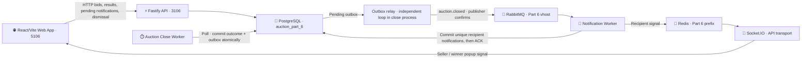

# Asynchronous Auction Close — Design Interview

Current authorization: issue #8 approves a behavior-preserving Part 6 Drizzle refactor and PR. Earlier slice review stops below are historical and do not block this refactor. All concurrency and notification guarantees remain required.

Status: Slice 1 reviewed. Slice 2 explicitly approved and implemented: confirmed publication, notification worker, idempotent recipient delivery and Redis/Socket.IO popups. Stop after verification for review.

## Fixed requirements

- Use Part 4 as the baseline. Never copy Part 5.
- Work only in Part 6. Exclude dependencies and generated output from the copy.
- Isolate Part 6 runtime configuration from all earlier parts.
- A polling close worker records the final auction outcome and an outbox event in PostgreSQL.
- RabbitMQ connects closing to a separate notification worker.
- The notification worker sends seller and winning-bidder popup signals through Redis and Socket.IO.
- At most two questioning rounds, followed by exactly two complete browser-reviewable slices for approval.
- Stop after each implemented and verified slice for user review before starting the next.

## Observed baseline

Part 4 protects bidding with an auction row lock and checks the acceptance deadline after acquiring it. Expiration is derived from time; no final outcome is persisted. Existing Socket.IO auction-room notifications are best effort and detail-page scoped. Demo user selection is not authentication. Shared infrastructure already exposes PostgreSQL, Redis and RabbitMQ; Part 6 must use isolated application resources.

## Accepted decisions — Round 1

- The existing bidding deadline remains authoritative. Finalization does not extend bidding.
- Persist the permanent highest accepted bid outcome, winner, winning amount and finalization time. Payments, cancellation, reopening and reserve prices are outside scope.
- No bids means “Ended without bids,” no winner or sale amount, and a seller-only notification.
- At the deadline disable bidding and show “Auction ended · finalizing result” until the recorded outcome is available.
- Seller and winner popups are available throughout the app. Other viewers see the detail-page outcome without a popup.
- Persist recipient notifications; recover undismissed notifications on initial load and reconnect.
- Show popups in all windows for the recipient; explicit dismissal is durable per recipient and clears across windows. Present multiple notifications one modal at a time.
- Poll for closure every second; healthy local target is popup delivery within three seconds of the deadline, not a hard guarantee.
- RabbitMQ or Redis outages must not block recording outcomes. Recover publication and notification delivery afterward.
- Preserve selectable demo identities; switching immediately clears the old participant’s popup and loads the selected participant’s pending notifications. This is not authentication.
- The attached decision table additionally specifies idempotent processing backed by database uniqueness constraints and defers dead-letter queues and elaborate retry infrastructure.

## Accepted decisions — Round 2

- The close-worker process hosts independent closing and outbox-relay loops. RabbitMQ delays must not block finalization. The notification worker remains a separate process.
- Concurrent close workers use auction row locks and skip locked rows. Database uniqueness enforces one outcome and one close event per auction. Preserve the existing post-lock bid acceptance-time check and coherent reads.
- Publish a versioned `auction.closed` event with a stable event ID, auction identity, seller, nullable winner and winning amount, closing time and finalization time. Validate boundaries with Zod; never recalculate the recorded winner.
- The notification worker commits recipient notifications before acknowledging RabbitMQ, then signals through Redis. Uniqueness on event ID and recipient makes redelivery idempotent; duplicate events never reset dismissal.
- HTTP recovery on initial load, reconnect, focus and five-second reconciliation closes missed-signal windows, including failure after acknowledgement but before Redis emission. A broker acknowledgement is not evidence of browser receipt.
- Retry transient failures with simple capped backoff and reconnect loops. Unconfirmed outbox events remain pending. Malformed or unsupported messages are rejected without requeue and logged structurally for investigation/manual recovery. No dead-letter queue or elaborate retry topology.
- Process all overdue unfinalized auctions in bounded batches, oldest first. Do not silently discard older results; queue pending popups one at a time.
- Isolate API 3106, web 5106, database `auction_part_6`, browser identity storage, Redis prefix and RabbitMQ vhost. Reuse shared services without modifying root Compose. Provide `npm start` and individual worker commands.
- Report dependency/component health separately. RabbitMQ downtime must not block HTTP bidding or finalization. Preserve usable HTTP state when realtime delivery is degraded.
- Popups show item title, recipient-specific result, winning amount when applicable and an auction link. Only explicit Dismiss acknowledges a notification. Navigation does not dismiss it. No timeout or backdrop dismissal; provide keyboard focus and retain the modal with retry feedback if dismissal persistence fails.

## Architecture

The API remains authoritative for notification contents and auction results. Redis/Socket.IO provides fast signals; durable notifications plus HTTP reconciliation provide recovery. Existing public auction-detail updates remain available. One API instance is sufficient; no multi-replica browser demonstration is required.

## Explicit limits

No payments, reserve rules, cancellation, reopening, real authentication, dead-letter queues or elaborate retry infrastructure. Popup delivery has a healthy-system latency target, not a hard deadline. Invalid message rejection requires log-based manual investigation; it is not durable quarantine. No exactly-once transport claim is made.

## Approval boundary

The user reviewed Slice 1 and approved Slice 2: publisher-confirmed pending outbox delivery, publication marking only after confirmation, separate notification worker, idempotent seller/winner notices and Socket.IO/Redis modals. Verify redelivery, recipient selection, tests, types and browser behavior, then stop for review. No additional capability is authorized. Historical Part 4 approvals remain historical.

## Design references

- https://microservices.io/patterns/data/transactional-outbox.html
- https://www.rabbitmq.com/docs/confirms
- https://socket.io/docs/v4/delivery-guarantees/
- https://socket.io/docs/v4/redis-adapter/
- https://www.postgresql.org/docs/current/sql-select.html
