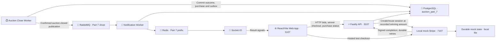

# Winner Checkout — Design Interview

Status: all Round 1 recommendations accepted; Slice 1 explicitly approved and implemented. All checks and the headed browser handoff passed; stopped for Slice 1 browser review. Slice 2 is not approved.

## Fixed requirements

- Build Part 7 from Part 6, preserving authoritative close results, bidding concurrency, recipient notifications and Drizzle data access.
- Use the supplied local Stripe-shaped mock; no real money moves.
- Inspect the mock before changing it. Keep changes within Part 7 unless the user explicitly expands scope.
- At most two interview rounds, followed by exactly two complete, browser-reviewable feature slices for approval before implementation.
- Finish and verify each approved slice, then stop for review before starting the next.
- Record resolved domain vocabulary in CONTEXT.md and decisions here as answers arrive.

## Observed baseline

Part 7 is empty. Part 6 persists immutable sold/no-bid outcomes and winner/amount, but has no purchase model. Demo identity is selected through the browser and sent as x-demo-user-id; it is not authentication.

## Supplied mock contract and relevant issues

Source: ../stripe-service/src/app.ts and src/index.ts; inspection only, no modifications.

- POST /v1/checkout/sessions accepts a purchase UUID as client_reference_id, exactly one USD line item with a positive integer cent amount and quantity 1, plus success/cancel URLs.
- It reuses one session per purchase and rejects changed title, amount or return URLs with 409 (app.ts:114–125). This differs from Stripe's general idempotency-key interface.
- GET /v1/checkout/sessions/:id returns session status and purchase reference, but omits amount/currency. The hosted page is /checkout/:id.
- Success card: 4242 4242 4242 4242. Decline card: 4000 0000 0000 0002. Declines keep the session open.
- Completion uses custom eventId/eventType/occurredAt fields and x-stripe-signature containing hex HMAC-SHA256 over the exact JSON body (app.ts:187–194). It is not the real Stripe SDK event/signature format; there is no signed timestamp freshness mechanism.
- Payment becomes paid before webhook delivery. A delivery failure returns 502 despite the mock already considering the session paid (app.ts:195–200).
- Retrying a completed payment resends the same event until acknowledged; there is no autonomous retry loop (app.ts:87–99,176–180). Closing the page can strand confirmation.
- Sessions, purchase-to-session reuse and pending completion events are held only in memory (app.ts:84). A restart loses all of them, including payment evidence.
- Webhook fetch has no explicit timeout (app.ts:80–82), so a hung receiver can hold the payment request open.
- Mock listens only on 127.0.0.1 (index.ts:13). This works with host npm processes, but not cross-container calls without configuration changes.
- Return URLs accept any URL. Application-generated fixed-origin returns are needed; browser-provided amounts, references and redirect URLs must not be trusted.

These are source-inspection findings, not test results. The mock's own tests are present, but dependencies are not installed and tests have not been run in this planning-only phase.

## Round 1 decision frontier

The user accepted all eight recommendations below. The observed contract remains distinct from the chosen integration behavior.

1. Purchase: one durable obligation per sold auction, tied to its recorded winner and winning USD amount; no purchase for no-bid outcomes; exclude fees, shipping, taxes and refunds.
2. Identity: preserve selectable demo users and enforce recorded-winner eligibility in the API. A hosted checkout URL is a bearer capability; no claim of real authentication.
3. Entry and visibility: winner checkout on auction detail, linked from winner outcome notice; seller sees payment status, other viewers see the auction result.
4. Authority: only a verified, validated completion webhook matching the stored purchase/session/amount/currency marks paid; redirects only trigger authoritative reads.
5. Retry semantics: cancellation and decline leave the purchase unpaid and retryable, with no payment deadline, forfeiture or re-awarding.
6. Consistency: concurrent clicks reuse the purchase/session; paid is terminal; duplicate valid events are acknowledged without repeating effects; mismatches cannot change payment state.
7. Mock scope: propose a self-contained Part 7 copy of the supplied mock for any approved fixes, preserving the shared original and earlier parts.
8. Recovery guarantee: propose autonomous webhook recovery while the browser is closed and durable mock sessions/events across process restart; implementation details depend on this answer.

## Review boundary

Round 1 acceptance and the explicit Slice 1 instruction authorize this implementation. No second round is needed. Verify all Slice 1 behavior, leave the headed demonstration open for browser review, and wait for confirmation before starting another slice.

## Accepted decisions and authorization

The user accepted all eight Round 1 recommendations and explicitly approved Slice 1 implementation, including the minimal mock fixes and specified checks. A second interview round is unnecessary. The latest instruction authorizes implementing and verifying Slice 1, then launching the headed bidding war and stopping for browser review. The winner's manual payment and a separate unpaid decline example must remain available.

Purchase creation belongs to authoritative sold-result recording, with a migration backfill for existing sold outcomes. Checkout uses fixed server-owned return origins. A successful mock payment may be awaiting confirmation, but application paid status comes exclusively from validated webhook processing. The custom signature has no time tolerance; durable event deduplication and purchase/session matching prevent repeated effects.

Mock persistence uses an atomically replaced local state file for a single mock process. Persist completed sessions and stable event bodies before delivery, retry in the background with capped backoff, and bound webhook requests. File storage is adequate for this local service's single-process contract; running multiple mock writers against one file is unsupported.

## Architecture

