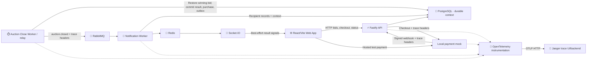

# Part 8 — Winning-workflow Observability Plan

Approved as one cohesive implementation by the user's latest instruction. Backend/worker/mock instrumentation, direct OTLP export to existing Jaeger and recording all meaningful business traces are accepted. Earlier planning gates and the two-slice review boundary are superseded. See README.md and VERIFICATION.md for executable walkthrough and observed results.

## Outcome and approved baseline

A reviewer can start from the winning bid in Jaeger and inspect the recorded close, confirmed message publication, recipient notification work, checkout, mock payment, signed webhook and paid purchase. Other accepted/rejected bids remain short traces. Application behavior and payment authority remain those of the eventual completed Part 7 baseline.

The user confirmed Part 7 is complete, verified and committed. Part 8 builds from commit `58037bfda8da2ac8685b01db61b907fefa0ea25f`. All application/migration/configuration changes stay inside Part 8; earlier parts and root Compose remain unchanged.

## Trace model

- Start a short business trace for each bid request. Persist the accepted bid's active W3C trace context with the accepted bid, in its existing transaction. A rejected/rolled-back bid must not leave a durable accepted-bid context.
- The close worker selects the authoritative winner under existing locks and restores that bid's context. Extend that trace with finite close/DB spans. Persist the resulting workflow context with the outcome, outbox and purchase in the same transaction. Do not keep the HTTP bid span open until the deadline or retroactively rewrite losing traces.
- No-bid auctions have a separate close workflow and no purchase/winning-bid parent. Older records without context use a clearly classified new root; never invent ancestry or change the winner.
- Restore durable outbox context for each relay attempt. Inject the current producer span's context into RabbitMQ headers, then extract/validate it at consumption. Use a fresh span per publish/delivery/retry attempt while preserving the stable business event ID.
- Persist recipient processing context with durable notification records where recovery needs it. Distinguish notification persistence, broker ACK and best-effort Redis/Socket.IO signal attempt. Do not label these as browser receipt/read.
- Restore the purchase's winning-workflow context for an authorized checkout action, even minutes later. Inject context server-to-server into mock session creation. Preserve purchase identity and context through session reuse or recovery after an unpaid session disappears.
- The mock durably stores context with its session and completion event. Hosted payment attempts restore session context; every foreground/background webhook delivery restores completion context and creates a new delivery-attempt span, including after restart.
- Webhook processing verifies the signature and purchase/session binding before trusting workflow association. Record receipt/deduplication/paid update under the stored workflow context. Trace headers and redirects never authorize payment or select another participant's workflow.
- Notification processing and checkout may be branches under the same winning trace: checkout can legitimately occur before a best-effort notification is displayed. Do not invent parentage or block business work to force a linear timeline. Use links for independently initiated request/attempt context where useful, while the trusted durable workflow owns the trace ID.
- Persist W3C traceparent and supported bounded tracestate where needed, not live Span objects or SDK internals. Validate carriers at boundaries. Do not propagate arbitrary baggage or business data in tracing headers. Do not export carrier values as arbitrary attributes; sanitize/drop untrusted tracestate entries rather than allowing excluded data through a side channel.

## Proposed service and infrastructure layout

Proposed service names: `auction-part-8-api`, `auction-part-8-close-worker` (including independent relay), `auction-part-8-notification-worker`, `auction-part-8-mock-stripe`. Keep their resource attributes minimal and explicit.

Runtime isolation: API 3108, web 5108, mock 7108, Part 8 application/test databases and schemas, RabbitMQ vhosts, Redis prefixes, browser identity key and mock state. Reuse existing infrastructure via documented npm/Docker commands. The default collection recommendation is direct SDK OTLP HTTP export to existing Jaeger on localhost:4318, UI on localhost:16686; no root Compose edits or separate collector are planned. Durable workflow context and in-memory Jaeger span retention remain separate.

OpenTelemetry in this diagram is instrumentation in each process, not a proposed new central application service. Only API, workers and mock are instrumented; browser behavior is verified separately. No application tracing screen is planned.

## Signal and privacy contract

Use stable business span names and a strict allowlist covering attributes, events, status descriptions and resource fields. Proposed operations include bid submit/acceptance, close, outbox publish, notification process/record/signal, checkout create/reuse/recover, mock payment attempt, webhook delivery/process, deduplication and purchase paid.

Allowed dimensions: opaque auction correlation ID, numeric demo participant IDs, bid/purchase/event/session/notification IDs, seller/winner role, integer cent amounts, USD currency, stable route templates, business outcome, attempt count, duplicate/redelivery indicator, component and bounded error category. These are trace attributes for investigation, not a proposal for high-cardinality metric labels.

Excluded everywhere in exported telemetry: names/handles, auction titles/descriptions, raw auction slugs, full URLs/query strings/return URLs, card/expiry/CVC, raw HTTP/message/webhook bodies, SQL text and bind parameters, authorization/signature/secret headers, connection strings and arbitrary exception messages/stacks. An otherwise useful-looking identifier is not safe merely because its field is named id.

Plan an opaque auction correlation UUID, persisted/backfilled via an explicit migration, rather than using a title-derived slug. Keep existing business identifiers/API routes intact. Sanitized constant exception categories and operation names provide failure evidence without exporting untrusted error content. Inspect actual exported OTLP data, not only the helper's intended attributes.

## Meaningful PostgreSQL spans and noise control

Keep finite spans around real business database work: auction lock acquisition and post-lock bid read/write, authoritative outcome/purchase/outbox transaction, publisher-confirmation marking, idempotent notification insert, purchase/session lock and bind, event deduplication and paid transition. Preserve lock-wait duration and rollback/failure evidence without recording query text. Use constant operation/table names and safe database-system attributes. Avoid a duplicate ORM span and driver span for every statement.

Do not blanket-disable PostgreSQL visibility. Conversely, do not enable all Node/driver instrumentation and rely on SQL sanitization: SQL text itself is excluded, including parameterized statements. Use selective/manual business and DB instrumentation with a final export allowlist.

Suppress health probes, empty close/outbox polling, catalog/status reconciliation, routine session lookups, idle Redis traffic, Socket.IO heartbeats, framework hooks and filesystem/DNS chatter. A polling worker emits a business span when it claims/processes real work; no span stays open while sleeping. A routine successful status read remains quiet, but an actual unexpected dependency failure can emit a concise sanitized diagnostic span without tracing every poll.

Business outcomes such as stale/late/self bid rejection, card decline, cancellation, duplicate event, no bids, session reuse/missing-unpaid-session recovery and pending confirmation do not automatically set ERROR because of HTTP 4xx or a particular returned result. Unexpected database failures, failed broker confirms and transport/timeouts may set ERROR with a safe category; retries and eventual success remain visible as separate attempts. Do not swallow or relabel genuine failures to make the trace look healthy.

Recommended local sampling: keep all meaningful business traces so an eventual winning bid is never sampled away before its identity is known. Suppression controls noise; do not confuse it with sampling. Trace export is best effort and must not fail bids, block closing, lose notifications or authorize/undo purchases. Durable context survives process restarts; SDK buffers and current Jaeger in-memory trace retention are not a durable telemetry queue.

## Implementation coverage — one cohesive handoff

### Auction/notification coverage — Winning auction and recipient notification visible in Jaeger

Deliver the actual browser bidding/close/notification experience with Jaeger showing the winning bid's DB work, authoritative close, outbox publication and recipient processing in one workflow. Other bids remain short. Include startup/export configuration, explicit context migrations, worker bootstrap, RabbitMQ propagation, role-safe attributes, privacy/noise filtering and tests as support for that visible result.

Review a headed tiled bidding war plus Jaeger: locate the winning trace by opaque IDs, inspect lock/commit/publish/recipient spans, and compare a rejected/losing bid's short trace. Verify no-bid outcomes and confirmed publication/redelivery without duplicate notification effects. Review this together with the complete golden workflow.

### Payment/recovery coverage — Checkout through paid purchase extends the winning workflow

Deliver the full winner checkout and seller payment-status experience with session creation/reuse/recovery, hosted mock attempts, signed webhook retries and paid transition extending the original winning trace. Preserve short business outcomes for decline/rejection; include delayed checkout, process restart and duplicate-webhook evidence. Do not change the existing payment authority, visibility or retry semantics.

Review actual winner checkout and seller status alongside Jaeger. Demonstrate decline remaining a business outcome, an unpaid session disappearing/recovering, and a completed payment whose confirmation retries after browser closure/mock restart, all without a second payment. Review this together with the complete golden workflow.

## Verification requirements

Executable commands are documented in AGENTS.md and README.md; observed evidence belongs in VERIFICATION.md:

- Run all tests/build/typechecks required by the eventual completed baseline. Document real Part 8 npm commands in its AGENTS.md and README once implementation exists.
- Test context persistence with transaction rollback, authoritative winner selection, multiple auctions, concurrent requests, restart, outbox publication retry, real broker redelivery and duplicate signed completion. No context bleed between workflows/participants; no duplicate business effects.
- Prove trace ID continuity from accepted winning bid to purchase paid in collected/exported spans. Short losing/rejected traces must not gain another auction's downstream work. New attempts have distinct span IDs and stable business IDs; no-bid and missing/invalid legacy context have explicit safe behavior.
- Assert meaningful PostgreSQL operation spans, expected business outcomes without automatic ERROR, and sanitized ERROR evidence for actual dependency failures.
- Enforce privacy against captured exporter/OTLP output using distinctive synthetic markers in titles/handles/card inputs/payloads/errors/SQL. Assert none appear in attributes, span names, events, status descriptions or resources. Assert raw SQL keys/text and full URL/query data are absent.
- Measure a quiet idle interval: no routine polling/health/framework span stream. Then perform business actions and require their spans. Verify missing-signal/status reconciliation continues to work even when routine successful reads are suppressed.
- Test Jaeger/exporter unavailability without business failure. Document the difference between durable context and lost telemetry buffers/backend retention.
- Browser verification uses real app actions plus Jaeger; no added in-app trace screen. Requested Playwright demonstrations use headed Chrome/Edge, sandbox enabled, separate tiled windows left open. Evidence goes to temp directories.

## Primary references

- [OpenTelemetry context propagation](https://opentelemetry.io/docs/concepts/context-propagation/): trace context crossing process boundaries.
- [OpenTelemetry database span conventions](https://opentelemetry.io/docs/specs/semconv/db/database-spans/): operation/database attributes; this plan intentionally excludes SQL text more strictly than optional upstream fields.
- [OpenTelemetry span status API](https://opentelemetry.io/docs/specs/otel/trace/api/#set-status): explicit span status; the application must classify expected business outcomes.
- [Jaeger 1.76 deployment documentation](https://www.jaegertracing.io/docs/1.76/deployment/): documentation matching the currently configured image, including OTLP and storage choices. Re-evaluate versions against the final baseline before implementation; no upgrade is authorized by this plan.
