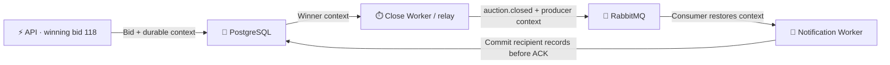

# Actual Winning-bid Trace — Headed Bidding War

Observed 2026-11-15. The complete Part 8 implementation was verified first; this is the additional requested headed bidding-war investigation.

[Open the collected winning trace in Jaeger](http://127.0.0.1:16686/trace/ec501b0bca6c8847a9d0591fd178cd65).

- Trace ID: `ec501b0bca6c8847a9d0591fd178cd65`
- Winning bid: **118**, demo participant **3**, **10,400 cents ($104)**.
- Opaque auction ID: `2430042d-b8ed-450d-9784-487fc117c3ef`.
- Close/publication/consumer event ID: `a46811d5-d8bd-4212-8904-31ecceb3f491`.
- Collected snapshot: 19 spans across API, close-worker and notification-worker services. The purchase was deliberately left unpaid; checkout/mock/webhook spans will extend this same trace after the winner completes checkout.
- Machine timezone: **Asia/Calcutta — IST, UTC+05:30**. The browser context explicitly uses this machine timezone, and the runner verified the exact Trace Start text in Jaeger.

## Observed spans

All wall-clock values below are local machine time on 2026-11-15. Durations are collected Jaeger values, not estimates.

| Span / service | Local start | Duration | Actual evidence |
| --- | --- | --- | --- |
| `auction.bid` / API | **22:19:08.505** | **16.530 ms** | Root span; `bid.id=118`, `participant.id=3`, `amount.cents=10400`, `business.outcome=accepted`. The request completed quickly; it was not held open awaiting close. |
| `auction.close` / close worker | **22:19:10.801** | **3.828 ms** | Direct child of that bid. Recorded `winner.id=3`, the same bid/amount, `business.outcome=sold`, `context.fallback=false`, `transaction.committed=true`. Outcome, purchase and outbox committed together. |
| `auction.outbox.publish` / close-worker relay | **22:19:11.659** | **5.251 ms** | Direct child of close; producer kind, matching event/auction IDs, `business.outcome=published`, `transaction.committed=true`. The publication promise waits for broker confirmation before marking the outbox row published. |
| `auction.notification.process` / notification worker | **22:19:11.671** | **3.219 ms** | Direct child of the producer; consumer kind, same event ID, `context.invalid=false`, `messaging.redelivered=false`, `business.outcome=recorded`, `transaction.committed=true`. Recipient rows exist for seller 1 and winner 3. |

The winning bid's UTC start is `2026-11-15T16:49:08.505Z`; Jaeger displays `November 15 2026, 22:19:08.505`. Underlying epoch timestamps were not shifted. Timeline offsets such as `792.6ms` remain elapsed durations, not UTC times to convert.

The bid-to-close start gap is **2.296 s**, which includes waiting until the deadline and the close worker's next poll. The deadline was 22:19:10.000 IST; the attempted $105 bid at 22:19:10.250 IST returned 409 and did not persist. The stored finalization timestamp was 22:19:10.794 IST (the worker’s clock reading before its per-auction span began at 22:19:10.801). Neither finalization nor tracing extended bidding. The independent relay's later poll explains the interval before publication; this is not a long-running HTTP request or a sleeping worker span.

## Verified ancestry

The runner asserted each parent ID against the collected span JSON:

| Span | Span ID | Parent span ID |
| --- | --- | --- |
| Bid | `6c0e582205a0f323` | none — trace root |
| Close | `6df6e3c239a55988` | `6c0e582205a0f323` |
| Publish | `0119781f1f8c1854` | `6df6e3c239a55988` |
| Consume | `dcae8cbe862058f0` | `0119781f1f8c1854` |

Signal spans and actual browser assertions separately verified seller/winner notifications; losing bidders received no original-auction popup. A successful signal is not a browser read receipt. Three simultaneous $101 submissions yielded 201/409/409 and only one stored equal bid; later bidding selected the $104 winner shown above.

## Open review windows

Four independent sandboxed Chrome windows are geometrically tiled 2×2 and remain open:

- Top-left: seller payment status for the $104 auction.
- Top-right: the winning trace in Jaeger, using local machine timestamps.
- Bottom-left: winner 3, **$104 unpaid**, with Complete purchase.
- Bottom-right: a separate winner 4 purchase, **$51 unpaid**, for decline/cancel review.

Complete the bottom-left checkout with the local success card if desired, then refresh the same Jaeger URL after its next export batch to see the payment branch. The earlier complete bid-to-paid golden trace is [e950dfc4351c70e936bae4e3a5adbf24](http://127.0.0.1:16686/trace/e950dfc4351c70e936bae4e3a5adbf24), with 41 spans across all four services and a completed $103 purchase.

## Files and shutdown

Evidence is under `/tmp/bidding-war-results-QN2MDc/`: `evidence.json`, `winning-trace.json`, app screenshots and `jaeger-winning-bid-local-time.png`. The runner waited for the required spans to arrive in Jaeger before declaring success. Application services and Jaeger remain running. Their shutdown path drains active work, force-flushes telemetry, then shuts down the SDK; the process supervisor gives a 15-second graceful shutdown budget rather than killing immediately.
